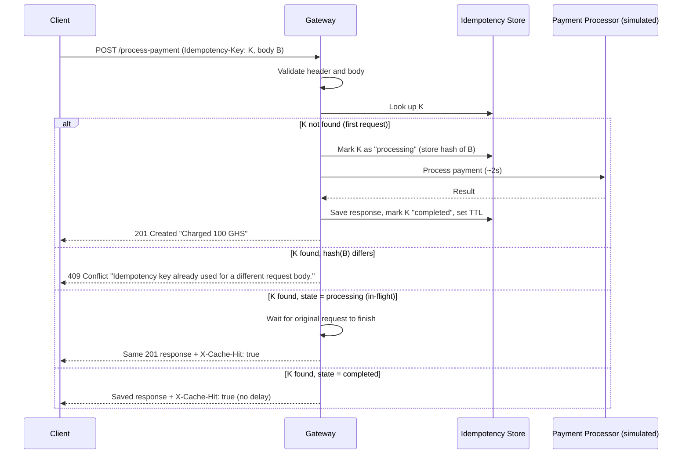

# Idempotency Gateway: The "Pay-Once" Protocol

An idempotency layer for FinSafe Transactions Ltd. It guarantees that a payment request is processed **exactly once**, no matter how many times the client retries it.

## 1. Architecture Diagram



## 2. Setup Instructions

Requires Node.js 18 or newer.

```bash
git clone git@github.com:King-Stev/AmaliTech-DEG-Project-based-challenges.git
cd idempotency-gateway
npm install
npm start          # listens on http://localhost:3000
```

**Environment variables (all optional):**
PORT : 3000                            
IDEMPOTENCY_TTL_MS : 86400000 (24h) --How long completed keys are remembered

## 3. API Documentation

#### POST /process-payment

| Header            | Required | Description                                       |
| ----------------- | -------- | ------------------------------------------------- |
| `Idempotency-Key` | Yes      | Unique string (max 255 chars) per logical payment |
| `Content-Type`    | Yes      | `application/json`                                |

Body: `{ "amount": 100, "currency": "GHS" }` (`amount` is a positive number, `currency` a 3-letter code)

Example:

```bash
curl -i -X POST http://localhost:3000/process-payment \
  -H "Content-Type: application/json" \
  -H "Idempotency-Key: order-1001xxxxxxxxxxxxxxxxxxxxxxxxxxxxxxxxxxxxxxxxxxx" \
  -d '{"amount": 100, "currency": "GHS"}'
```

| Scenario                          | Status | Body                                                                     | Notes                           |
| --------------------------------- | ------ | ------------------------------------------------------------------------ | ------------------------------- |
| First request                     | `201`  | `{"status":"success","message":"Charged 100 GHS"}`                       | Takes ~2s                       |
| Same key, same body               | `201`  | identical to first                                                       | Instant, `X-Cache-Hit: true`    |
| Same key, different body          | `409`  | `{"error":"Idempotency key already used for a different request body."}` |                                 |
| Same key while first is in flight | `201`  | identical to first                                                       | Waits, then `X-Cache-Hit: true` |
| Missing/invalid key, bad body     | `400`  | `{"error":"..."}`                                                        | Never stored                    |

### `GET /health`

Returns `{"ok": true}`.

## 4. Design Decisions

- **Store:** an in-memory `Map`. It keeps the project dependency-light and easy to run. The store is isolated in `src/store.js`, so swapping in Redis is a contained change.
- **Race-condition safety:** the lookup and the "mark as processing" step happen synchronously in the same event-loop tick, so two requests cannot both claim the same key. The in-flight entry holds a Promise; duplicates simply `await` it (the Bonus story) instead of returning 409 or reprocessing.
- **Body comparison:** the body is canonicalized (sorted keys, uppercase currency) and hashed with SHA-256, so `{"a":1,"b":2}` and `{"b":2,"a":1}` count as the same request. A different body under the same key returns `409 Conflict`.
- **Status codes:** the first success returns `201`, and replays return the exact same status and body.
- **Failures are not cached:** if processing throws, the key is removed so the client can retry safely. Validation errors (400) are never stored.

## 5. Developer's Choice: Key Expiry (TTL)

**What:** completed idempotency keys expire after 24 hours (configurable via `IDEMPOTENCY_TTL_MS`). Expired keys are removed lazily on lookup and by a background sweeper.

**Why:** without expiry the store grows forever, which is a memory leak in production and a real cost on Redis. Retries from timeouts happen within seconds to minutes, so a 24h window covers all realistic retries while keeping storage bounded.
A reused key after expiry is treated as a brand-new payment.

Also included: strict input validation (400 errors), so garbage requests never consume a key.
